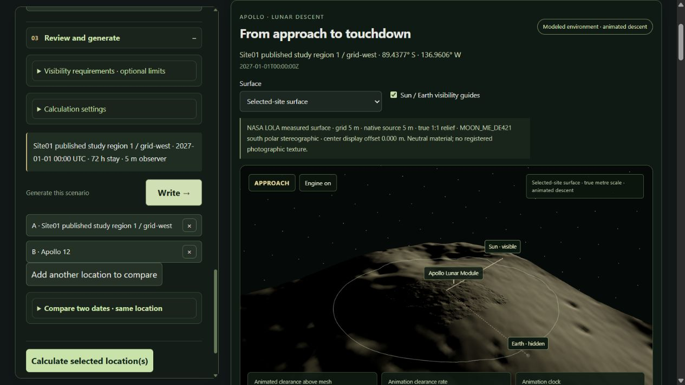

# Current entry point: the Moon globe workspace

The landing view is now integrated into the main globe. Choose a site/time → **Generate** → **Simulate landing**. Earth/Sun models, synchronized multi-site views and the current controls are documented in [Unified Moon environment](UNIFIED_3D.md). The former header shortcut and separate landing tab have been retired. The sections below retain the preceding implementation evidence; the unified workflow supersedes their entry-point and neutral-material descriptions.

# Simulate: selected-site terrain and observer sky

## Use it

1. Choose a catalogue site or enter custom coordinates, set arrival/stay and observer height, then **Write** to calculate.
2. Open **Simulate**. **Selected-site surface** uses that result's surface; its source and resolution appear above the canvas.
3. Use **Site + Sun / Earth** to see both guides, **Face Sun / Face Earth** to inspect each direction, or follow the lander.
4. Scrub **Mission conditions** or use **Play conditions**. This is the same sampled UTC as the main planning replay. It updates directions, visibility, Sun lighting and the compass without resetting the descent.
5. Independently start/pause/seek the illustrative descent. It reaches touchdown at animation second 58 and ends at 66. Its elapsed seconds are not astronomical mission time.
6. Choose **Supplied Moon model demo** or **Whole Moon · model overview** to retain the original model experience. These views explicitly identify the unregistered, compressed-scale model.

## Measured surface

The existing locally installed [NASA PGDA adjusted LOLA terrain products](https://pgda.gsfc.nasa.gov/products/90) supply elevation, rather than invented craters. No new user download is needed on this installation. Source identities and coverage checks remain in the scientific result. The worker creates a 1.2 km landing display patch at 5 m spacing when local 5 m data is available, otherwise 20 m spacing. Each patch records counts of the actual source resolutions used, its MOON_ME_DE421 polar projection and a display-only scope. Native resolution may vary within a patch; interpolation adds no source detail. A broader 5 km display mesh remains around it at 50 m spacing. Older prepared results may provide only their existing coarser display mesh.

Both meshes are transformed to the selected location's curved local east/north/up frame at true metre scale. Bilinear height sampling places the animated target at the selected point. The center interpolation offset is disclosed; recentering is display-only and does not change ground elevation, profiles or visibility calculations. The path stays inside the available surface; missing samples are rejected. Terrain display is separate from the mixed-resolution 180 km horizon rays.

Global reference-sphere results instead display their smooth curved sphere patch. They never borrow another site's measured terrain or show the supplied GLB as measured ground. Neutral gray material is used on calculated surfaces: a registered photographic texture has not been established. The user-supplied Moon's imagery remains confined to its explicitly labeled model mode/overview.

## Sun, Earth and visibility

The selected result supplies Sun/Earth azimuth, elevation, center clearance, visibility and UTC directly from the existing scientific engine. On-demand observations currently come from [JPL Horizons](https://ssd.jpl.nasa.gov/horizons/); historical prepared data retains its own recorded provider. The simulation introduces no substitute ephemerides, refraction or visibility calculation. Existing frame-alignment and model limitations still apply.

Solid guides mean the result's visibility test passes; dashed coral guides mean hidden. Lines originate at the fixed surface observer at the chosen 2, 5 or 10 m height, not at the moving spacecraft. Enlarged Sun/Earth symbols are placed at illustrative radial distance for readability. They are directional symbols, not correctly scaled bodies or independently modeled Earth imagery. A faint outline traces the result's angular horizon, including terrain outside the local displayed patch. The compass and numerical readouts remain available even when bodies are behind the camera. The outline and hidden guides deliberately remain visible through the mesh as explanatory overlays.

The sampled mission slider preserves the calculated cadence (1 or 10 minutes); it does not imply smooth real-time astronomical observations between samples. Selected-observation lighting is enabled when a valid observation first arrives. It follows that Sun direction and fixed-observer sunlight state; it is not a spatial shadow/illumination solver for all terrain points or moving-spacecraft altitudes. Uncheck it to use explicitly labeled studio fill for legibility.

## What is still illustrative

The supplied Apollo model is normalized to 7 m. An analytic easing trajectory changes clearance above the display mesh; it is not a lunar flight-dynamics solution. Clearance rate describes the animation parameter, not inertial vehicle velocity over sloping terrain. Fuel, thrust, guidance, gear contact, hazard clearance, collisions, altitude-dependent communications and plume/dust physics are not predicted. A target marker or animated touchdown does not establish a safe landing.

## Verification — 2026-11-15

- All 133 JavaScript checks passed, including five added checks for true local surface registration, lunar curvature, missing-data rejection, exact-pole/longitude conventions, smooth reference-sphere behavior and fixed-observer sky metadata.
- Six Python navigator checks and six reference-sphere checks passed; the changed worker compiles.
- Real local service calculation: Site01 grid-west, -89.43769015124919 N / -136.96060443682686 E, 2027-01-01 00:00 UTC, 72 h, 2 m. Returned 241 × 241 display samples, all from 5 m sources. The full animated path has valid sampled ground, spanning -5.770 to 0 m relative to the target. Horizon cache cold / observations cached: 16.774 s, peak working set 581,652,480 bytes on this machine. This is one performance observation, not a general bound.
- Result identity: `1ef20bc2df07ac13d0747af03d1d7c55807dbd186cbd76591b6d4b7e66e44b50`. Adding the display patch changes the worker identity and invalidates its source-aware horizon cache; horizon formulas were not changed.
- Browser inspection confirmed actual imported models on measured terrain, both celestial guides/labels in the wide context camera, separate descent and mission clocks, and retained model-mode switching. Moving mission time from index 0 to 431 updated the Sun from azimuth 40.08° / elevation 1.44° to 3.64° / 1.53°, Earth from 144.11° / -6.70° to 141.59° / -7.32°. Both mission sliders agreed at 431. Descent reached 0.0 m with engine off at the end.
- Switched between a measured polar site and Apollo 12: the latter displayed a smooth reference sphere and explicitly stated that measured terrain was absent. Recalculating at 5 m observer height updated the guide origin/readout to 5 m. The browser reported no captured errors.
- At 390 px, document width was 375 px and canvas width 320 px; final-descent surface, lander, HUD and controls were inspected. These are rendering/workflow checks, not independent landing-physics validation.

## Historical model-only implementation

The section below preserves the initial 2026-11-14 implementation evidence. The selected-site surface and observer sky behavior above supersede its model-only surface and default-lighting descriptions.

# Simulate: Apollo descent onto the Moon

Open **Simulate** in the header or the visual workspace tabs. A planning result and Meta API key are not required to try the demonstration.

## Controls

- **Start / resume landing** plays a 66-second illustrative sequence: approach, braking, final descent, touchdown at 58 seconds, then a short settling interval.
- **Pause**, **Reset** and the descent slider support replay and seeking. At the end, **Replay landing** starts again.
- Playback speeds: 0.5×, 1×, 2× and 4×.
- Cameras: **Follow lander**, **Surface observer**, **Whole Moon**, and **Free orbit**. Dragging the scene yields to free orbit; scroll zooms.
- **Full screen** expands the experience. Escape leaves full screen.
- With the canvas focused, Space plays/pauses and the arrow keys seek by one second; Shift+arrow seeks by five seconds.

Playback is initially paused and stops when the view or browser tab is hidden. The descent slider is independent of the scientific mission visibility replay. Seeking uses absolute animation time, so returning to a time restores the same vehicle pose and effects.

## Supplied assets

The original files were copied without altering the downloads:

| Supplied file | Local application asset | Size |
|---|---|---|
| Apollo Lunar Module.glb | data/models/apollo-lunar-module.glb | 716,840 bytes |
| moon.glb | data/models/moon.glb | 53,884,300 bytes |

SHA-256 identities and available provenance are in `data/models/manifest.json`. Geographic registration, source attribution and redistribution licenses were not supplied with these files; the manifest identifies them as user-provided context. No public publication is performed by this implementation.

The lander uses Draco compression. Matching Three.js 0.187 loaders, utilities and Draco decoding files are bundled under `src/vendor/`; no runtime CDN is needed. Three.js retains its MIT license, and the Draco README links to its Apache 2.0 license. Models are loaded lazily when Simulate opens, and retained for subsequent camera/view changes. The initial model transfer is about 54.6 MB.

## Scale, motion and context

The supplied lander is normalized to a 7 m display height, using the bounding box of the complete model. NASA describes the Apollo lunar module as approximately 7 m high with extended legs. This normalization is a display reference, not verification of each component's dimensions. [NASA EVA reference, Apollo Lunar Module dimensions](https://www.nasa.gov/wp-content/uploads/2017/02/2018-_eva_airlocks_and_alternate_ingressegress_methods_document.pdf)

The Moon model is deliberately compressed to a 1,000-unit display height to make a whole-Moon overview and a close descent readable within the same scene. A downward ray against the supplied mesh defines the visual touchdown reference. The lander approaches from an animated height of 180 visual metres and reaches zero height and speed at touchdown. The analytic easing curve is not an integrated lunar flight solution.

The model surface is not registered to a selected latitude/longitude and is not the measured terrain used by the scientific navigator. The target ring marks a visual contact point, not a certified landing zone. Collision dynamics, landing-gear compression, hazards, fuel, thrust limits, guidance and operational landing safety are not solved. Plume and dust are illustrative; dust follows deterministic short arcs rather than atmospheric smoke.

Selecting or calculating a planning site updates the context label. When a calculated Sun observation exists, **Use selected observation’s Sun lighting** applies its local azimuth, elevation and modeled visible/hidden state. Studio lighting remains the default for readability. Neither lighting mode computes registered surface shadows or changes the scientific visibility results. The astronomical observation time stays separate from animation time.

## Verification

Three motion tests cover deterministic seeking, monotonic height, touchdown endpoints, nonnegative height/speed, and plume/dust shutdown. The targeted suite also retains the AI plan validation and navigator regression checks (21 checks passed).

Browser inspection loaded both supplied models with the local decoder and observed the lander standing on the Moon at touchdown, with zero displayed height/speed and engine off. Seeking to 46.2 seconds produced final descent at 5.4 visual metres. Whole-Moon and close camera views were inspected. Switching away paused the animation. A calculated Apollo 12 scenario supplied the context and enabled the Sun-lighting option. At 390 px, the page had no horizontal overflow (375 px document width in a 390 px viewport); final-descent controls and the imported lander remained visible. These are renderer/workflow checks, not flight-dynamics or terrain-accuracy validation.
