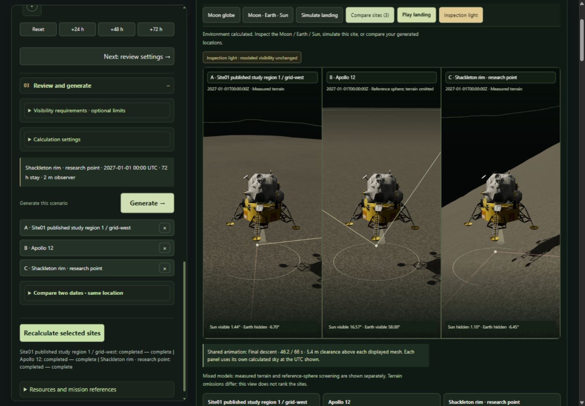
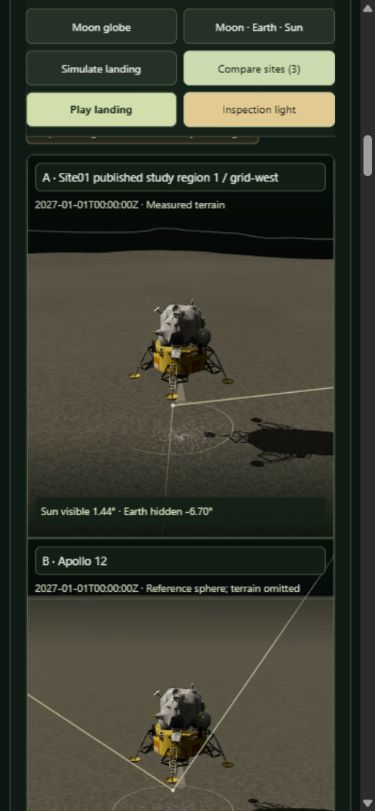

# Unified Moon environment

## Product flow

Choose a catalogue location or custom coordinates, set arrival, duration and observer height, then **Generate**. The Moon globe remains the primary workspace. **Moon · Earth · Sun** frames the calculated observer directions; **Simulate landing** switches the same canvas to the selected local surface. **Play landing** starts the illustrative descent. Clearly labeled inspection lighting is the default. **Inspection light** switches between inspection and calculated-Sun lighting. Inspection lighting makes a dark vehicle/surface readable without altering scientific visibility.

Generate up to three selected locations and choose **Compare sites**. Panels share the selected exact UTC and animation phase. Each panel uses its own calculated surface, Sun/Earth state, source/model label and independent metrics. Missing data or missing exact samples stay unavailable. At narrow widths the panels stack. Clicking a panel's site title selects its scientific inspection context. Existing side-by-side tables, cards, seasonal comparisons, timeline, uncertainty, engineering controls and exports remain available.

The header simulation shortcut and separate landing tab have been removed. Globe selection, the Earth/Sun environment, single-site landing and split landing views share one WebGL renderer and canvas. Global-radius and local-metre scenes use distinct camera scales behind that shared workspace; the lander is not rendered as a microscopic 7 m object on a Moon-radius camera.

## Models and surface

The user-provided Earth and Sun files are preserved as `data/models/earth.glb` and `sun.glb`; original downloads are unchanged. Sizes, SHA-256 identities and supplied filenames are recorded in `data/models/manifest.json`. Models load once per page and are reused. The Apollo asset is loaded when simulation opens; the large optional Moon GLB loads only for its explicitly labeled model demo.

Sun/Earth positions follow calculated local azimuth/elevation, transformed into the globe's lunar axes. Guide lines retain visible/hidden state. Diagrammatic body sizes and radial distances, texture orientation and model lighting are illustrative. The models do not establish calibrated body orientation, phase, eclipse geometry or spacecraft-altitude visibility. Scientific visibility continues to use the existing engine and provenance.

The primary globe retains its NASA LROC context imagery and geographic picking. Calculated landing meshes retain measured LOLA elevation, lunar curvature and native-resolution/source disclosures. Reference-sphere calculations remain smooth and omit actual terrain. Neutral regolith-colored material and deterministic fine grain improve close viewing without changing mesh elevations or any solver value. Grain is decorative shading, not measured roughness, photographic registration or hazard detail. Selecting a site with no elevation dataset does not manufacture craters.

Mixed reference-sphere and measured-terrain comparisons have an explicit notice. No automatic scientific ranking is introduced. Requirement status includes the continuous-activity constraint from the ordinary comparison, alongside separate total and continuous windows.

The descent remains a 66-second illustrative sequence with touchdown at 58 seconds. Its clock is independent of the mission's sampled UTC. Fuel, thrust guidance, safe gear contact, collision dynamics and flight trajectory validation remain outside this visual implementation.

## Acceptance evidence — 2026-11-15

- 138 JavaScript checks passed, including five comparison/asset checks for exact UTC matching, missing-data rejection, viewport coverage, byte-preserved body assets and continuous-activity failure preservation. Existing scientific/coordinate and deterministic animation checks remain passing.
- Browser acceptance passed with actual local scientific jobs: Site01 grid-west, Apollo 12 and the Shackleton rim research point, arrival 2027-01-01 00:00 UTC, 72 h, 2 m observer. The Shackleton calculation retrieved uncached JPL observations; no prepared-site result was substituted.
- The shared primary workspace contained exactly one canvas in globe, single-site and three-site modes. Earth/Sun assets reported loaded; both textured models and their guides were observed with the textured Moon in the system view. The requested header shortcut and separate landing tab are absent.
- Three desktop panes used independent models and returned distinct states at arrival: Site01 Sun 1.44° visible / Earth -6.70° hidden; Apollo 12 Sun 16.57° visible / Earth 58.00° visible; Shackleton Sun 1.10° hidden / Earth -6.45° hidden. The mixed-model notice was present. Summary failures included the continuous-activity requirement, matching ordinary comparison output.
- At mission index 431, all three panels changed to 2027-01-03 23:50 UTC and the main/scene replay indices agreed. Their Sun elevations were 1.53°, -19.81° and 1.15° respectively; Earth elevations were -7.32°, 60.22° and -7.08°. The independently paused descent remained at 46.2 s while changing UTC. Live descent playback also reached 66 s / zero animated clearance / engine off.
- Keyboard Enter selected another panel's site without losing comparison mode or its shared animation phase. Changing the candidate location returned the workspace to the globe and withheld simulation until the requested result existed.
- At a 390 px viewport, document width was 375 px and canvas width 320 px. Three panes stacked at offsets 0 / 399 / 798 px with 399 / 399 / 400 px heights. A scroll margin kept the first site header below the sticky controls (canvas y≈160 px; controls bottom 142 px). Temporary viewport overrides were reset.
- A fresh reload restored all three saved locations, recalculated their summaries and enabled comparison. No browser errors or server error output were captured during the acceptance run.

These are software/rendering checks, not independent ephemeris, terrain, flight or landing-safety validation.

